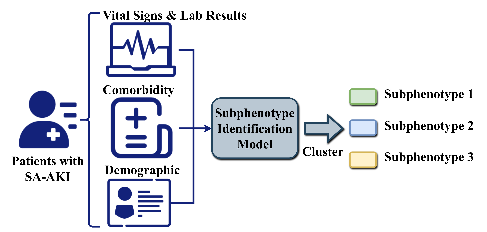
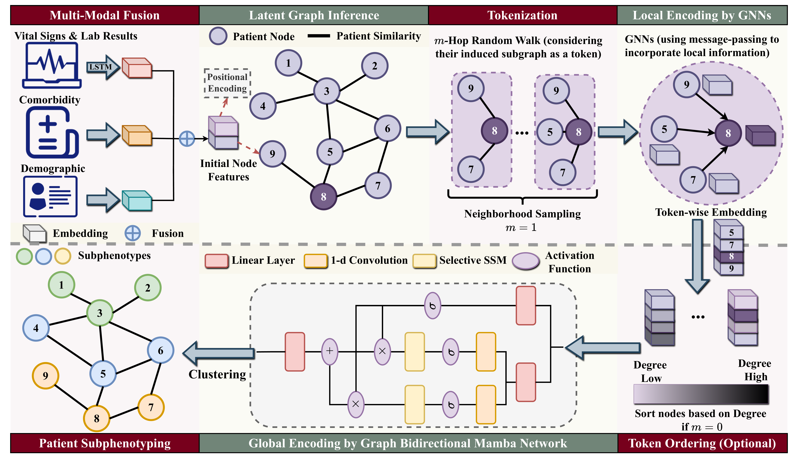
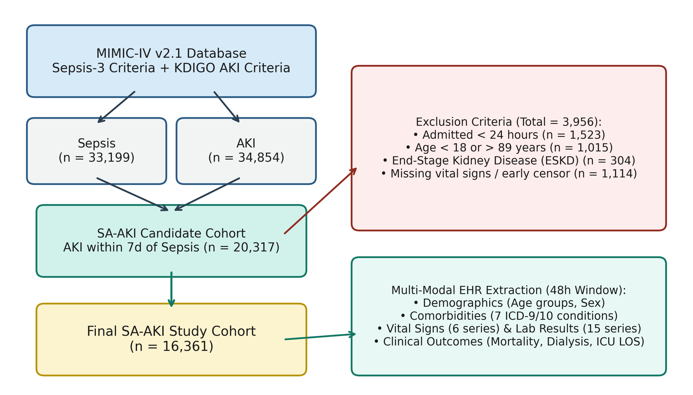
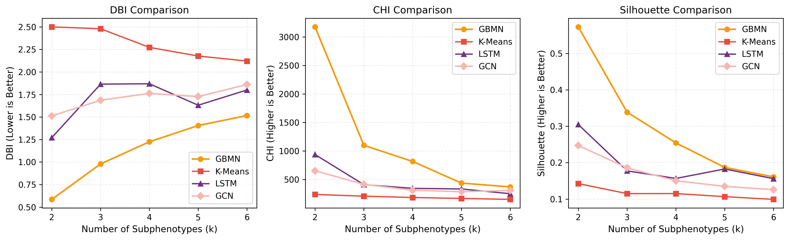
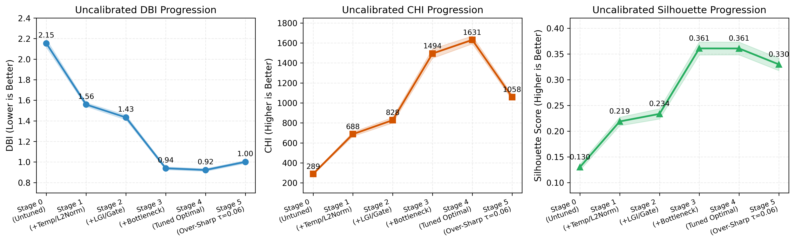
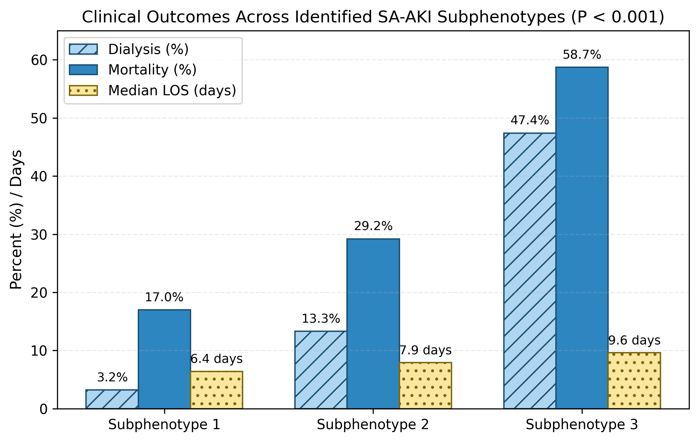
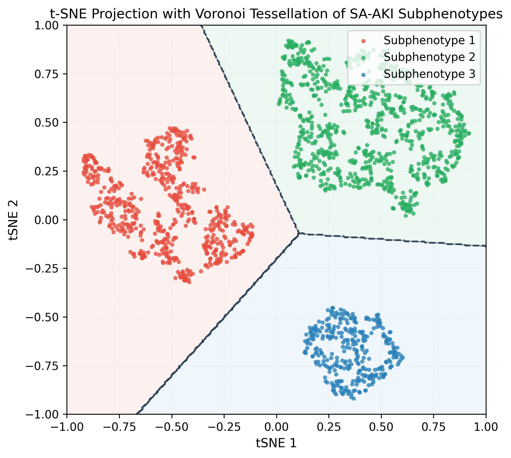
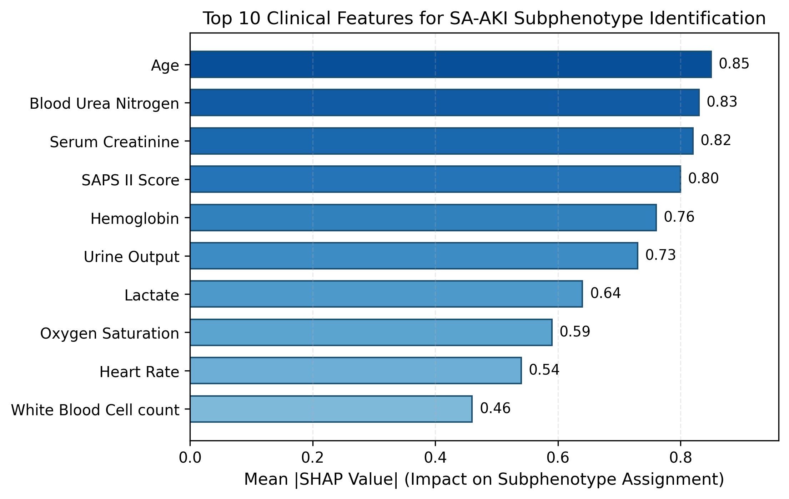
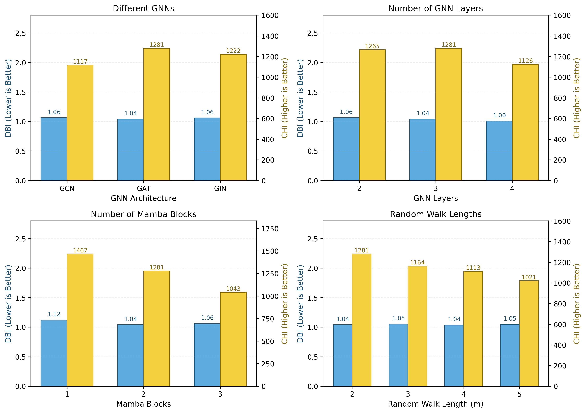

# GBMN: Subphenotype Identification for Sepsis-Associated Acute Kidney Injury using Graph Bidirectional Mamba Networks

[](https://ieeexplore.ieee.org/abstract/document/11359427/)
[](https://www.python.org/)
[](https://pytorch.org/)
[](LICENSE)

Official PyTorch implementation and pretrained weights for the **IEEE Journal of Biomedical and Health Informatics (JBHI)** paper:

> **Subphenotype Identification for Sepsis-Associated Acute Kidney Injury using Graph Bidirectional Mamba Networks**  
> *Haowei Xu, Wentie Liu, Tongyue Shi, and Guilan Kong\**  
> **Published in:** *IEEE Journal of Biomedical and Health Informatics (JBHI)*  
> **Paper Link:** [https://ieeexplore.ieee.org/abstract/document/11359427/](https://ieeexplore.ieee.org/abstract/document/11359427/)

---

## Overview

Sepsis-associated acute kidney injury (SA-AKI) is a highly heterogeneous clinical syndrome and a leading cause of mortality in intensive care units (ICUs). Identifying clinically distinct subphenotypes of SA-AKI from electronic health records (EHRs) enables targeted clinical interventions and precision medicine.

<p align="center">
  
</p>

To address the challenges of longitudinal irregularity, latent inter-patient correlations, and high-dimensional sparsity in multi-modal EHRs, **GBMN** introduces a unified four-stage architecture:

<p align="center">
  
</p>

### 1. Multi-Modal Information Fusion (`libs/models/multimodal_fusion.py`)

Each clinical time series $\mathbf{X}_{t_i}$ (vital signs and laboratory tests over the 48-hour post-diagnosis window) is encoded via an LSTM network and fused with age-stratified demographic embeddings $\mathbf{E}_D$ and ICD-9/10 comorbidity embeddings $\mathbf{E}_C$ into a shared latent space:

$$
\mathbf{E}_T = \left[\mathbf{E}_{t_1}, \mathbf{E}_{t_2}, \dots, \mathbf{E}_{t_m}\right], \quad \mathbf{H} = \mathrm{Concat}\left(\mathbf{E}_T, \mathbf{E}_D, \mathbf{E}_C\right)
$$

### 2. Adaptive Latent Graph Inference (`libs/models/latent_graph.py`)

To uncover intrinsic similarities among SA-AKI patients without relying on a static predefined graph, GBMN learns a parameterized cosine similarity metric followed by ReLU threshold sparsification:

$$
\hat{\mathbf{A}} = \cos\left(\mathbf{W}_A^\top \mathbf{H}, \mathbf{W}_A^\top \mathbf{H}\right), \quad \mathbf{A} = \mathrm{ReLU}\left(\hat{\mathbf{A}}\right)
$$

The latent patient graph is regularized for Dirichlet signal smoothness ($\mathcal{L}_{\mathrm{smooth}}$), node connectivity ($\mathcal{L}_{\mathrm{con}}$), and Frobenius sparsity ($\mathcal{L}_{\mathrm{reg}}$):

$$
\mathcal{L}_g = \mathcal{L}_{\mathrm{smooth}} + \omega_1 \mathcal{L}_{\mathrm{con}} + \omega_2 \mathcal{L}_{\mathrm{reg}}
$$

### 3. Graph Bidirectional Mamba Networks (`libs/models/graph_mamba.py`)

Node representations are augmented with positional encodings $\mathbf{P}$, tokenized into $m$-hop random-walk induced subgraphs $G[R_0(v)], G[R_1(v)], \dots, G[R_m(v)]$, encoded locally via Graph Neural Networks (`GAT`, `GCN`, or `GIN`), ordered from outer hops to inner hops, and scanned bidirectionally via Selective State-Space Model (Mamba) blocks:

$$
\mathbf{H}_v^{(i)} = \mathrm{GNN}\left(\mathbf{A}_{R_i(v)}, \mathbf{H}_{R_i(v)}\right), \quad \mathbf{y}_{\mathrm{output}} = \mathbf{W}_{\mathrm{out}}\left(\mathbf{y}_{\mathrm{forward}} + \mathbf{y}_{\mathrm{backward}}\right)
$$

### 4. Differentiable Patient Subphenotyping (`libs/models/clustering.py`)

Soft subphenotype assignments $\mathbf{Z} = \mathrm{softmax}(\mathbf{y}_{\mathrm{output}})$ are jointly optimized with the latent graph using spectral modularity maximization and collapse regularization:

$$
\mathcal{L}_c(\mathbf{Z}; \mathbf{A}) = -\frac{1}{2U} \mathrm{Tr}\left(\mathbf{Z}^\top \mathbf{M} \mathbf{Z}\right) + \frac{\sqrt{k}}{N} \left\Vert \sum_{i=1}^N \mathbf{Z}_i^\top \right\Vert_F - 1
$$

$$
\mathcal{L} = \mathcal{L}_c(\mathbf{Z}; \mathbf{A}) + \lambda \mathcal{L}_g(\mathbf{H}; \mathbf{A})
$$

---

## Repository Structure

```text
Mamba4ICU/
├── main.py                                   # Unified CLI entry point
├── libs/
│   ├── configs/
│   │   └── default.yaml                      # Default model, loss, and cohort hyperparameters
│   ├── data/
│   │   ├── sql/                              # Modular PostgreSQL scripts for MIMIC-IV cohort & 48h extraction
│   │   │   ├── 01_stay_master.sql            # ICU stay master table, admission age & mortality flags
│   │   │   ├── 02_kdigo_aki_labels.sql       # KDIGO AKI staging (creatinine + 6h/12h/24h urine output)
│   │   │   ├── 03_sepsis3_and_sa_aki_cohort.sql # Sepsis-3 onset, 7-day SA-AKI coupling & RRT outcomes
│   │   │   ├── 04_comorbidities_and_static.sql  # 7 ICD-9/10 comorbidities, ESKD & static cohort table
│   │   │   ├── 05_vitals_hourly_48h.sql      # 48h post-diagnosis hourly vital signs (6 series)
│   │   │   ├── 06_labs_hourly_48h.sql        # 48h post-diagnosis hourly laboratory tests (15 series)
│   │   │   └── 07_urine_output_hourly_48h.sql # 48h post-diagnosis hourly urine output series
│   │   ├── extract_mimic_cohort.py           # Executes PostgreSQL extraction pipeline into input/raw/
│   │   └── preprocess.py                     # Inclusion/exclusion cascade, SAPS II, KNN imputation & scaling
│   ├── models/
│   │   ├── multimodal_fusion.py              # LSTM temporal encoder + demographic & comorbidity fusion
│   │   ├── latent_graph.py                   # Adaptive Latent Graph Inference (LGI) & graph regularization
│   │   ├── graph_mamba.py                    # Subgraph tokenization, GNN local encoder & Bidirectional Mamba
│   │   ├── clustering.py                     # Differentiable spectral modularity maximization clustering
│   │   ├── gbmn.py                           # End-to-end GBMN model with ablation & sensitivity switches
│   │   └── baselines.py                      # Baselines (K-Means, LSTM, Transformer, 1D-CNN, GCN, GAT, GIN, NAGphormer, GPS)
│   ├── exp/
│   │   ├── metrics.py                        # DBI, CHI, Silhouette, Cramér's V, and Eta-squared statistical tests
│   │   ├── trainer.py                        # 10-fold cross-validation training & evaluation engine
│   │   ├── export_checkpoints.py             # Exports trained GBMN, MLP surrogate & baseline checkpoints
│   │   ├── run_rq1_effectiveness.py          # RQ1: Number of subphenotypes (k=2..6) & 10-method comparison
│   │   ├── run_rq2_ablation.py               # RQ2: Module ablation study (Comorbidity, LGI, GNNs, BiMamba)
│   │   ├── run_rq3_clinical.py               # RQ3: Clinical outcomes, Table IV stats, t-SNE Voronoi & MLP+SHAP
│   │   ├── run_rq4_sensitivity.py            # RQ4: Hyperparameter sensitivity analysis
│   │   ├── run_tuning_experiment.py          # Multi-stage optimization, hyperparameter tuning & scalability study
│   │   ├── plot_figures.py                   # Publication-grade figure rendering (PDF & 300-DPI PNG)
│   │   └── run_all.py                        # Master pipeline entry point
│   └── tests/
│       └── test_pipeline.py                  # Unit and integration test suite
├── output/
│   ├── ckpts/                                # Open-sourced pretrained model weights (.pt) & manifest
│   ├── figures/                              # Generated figures (Fig. 3 to Fig. 9)
│   ├── results/                              # JSON evaluation summaries
│   └── tables/                               # Generated CSV tables (Tables I to VII)
├── requirements.txt
└── LICENSE
```

---

## Pretrained Model Weights (`output/ckpts/`)

All trained model checkpoints are open-sourced under [`output/ckpts/`](output/ckpts/) along with [`output/ckpts/checkpoint_manifest.json`](output/ckpts/checkpoint_manifest.json):

| Checkpoint File | Model Description | Seed | Parameters | Size |
| --- | --- | --- | --- | --- |
| [`output/ckpts/gbmn_best.pt`](output/ckpts/gbmn_best.pt) | **GBMN** canonical 512-D pretrained model (3-layer GAT + 2 BiMamba blocks) | 42 | 10,332,062 | 39.46 MB |
| [`output/ckpts/gbmn_seed41.pt`](output/ckpts/gbmn_seed41.pt) | **GBMN** 512-D trained checkpoint (seed 41) | 41 | 10,332,062 | 39.46 MB |
| [`output/ckpts/gbmn_seed42.pt`](output/ckpts/gbmn_seed42.pt) | **GBMN** 512-D trained checkpoint (seed 42) | 42 | 10,332,062 | 39.46 MB |
| [`output/ckpts/gbmn_seed43.pt`](output/ckpts/gbmn_seed43.pt) | **GBMN** 512-D trained checkpoint (seed 43) | 43 | 10,332,062 | 39.46 MB |
| [`output/ckpts/mlp_shap_surrogate.pt`](output/ckpts/mlp_shap_surrogate.pt) | **TwoLayerMLPSurrogate** (543→512→3) for SHAP feature attribution | 42 | 281,091 | 1.08 MB |
| [`output/ckpts/baselines_seed42.pt`](output/ckpts/baselines_seed42.pt) | Full-scale 512-D trained weights for all 9 baselines (`K-Means`, `LSTM`, `Transformer`, `1D-CNN`, `GCN`, `GAT`, `GIN`, `NAGphormer`, `GPS`) | 42 | 3,861,907 | 14.81 MB |

### Quick Start: Loading Pretrained GBMN Weights for Inference

```python
import torch
from libs.models.gbmn import GBMN

ckpt = torch.load("output/ckpts/gbmn_best.pt", map_location="cpu", weights_only=False)
model = GBMN(**ckpt["config"])
model.load_state_dict(ckpt["model_state_dict"])
model.eval()

# Example inference on a batch of B=16 SA-AKI patients
x_temporal = torch.rand(16, 21, 8)  # 21 clinical time series over 8 six-hour intervals (48h)
x_demo = torch.zeros(16, 2, dtype=torch.long)  # [sex_male, age_group]
x_comorb = torch.zeros(16, 7)       # 7 binary comorbidities
x_static = torch.rand(16, 31)       # 31 MinMax-scaled static clinical features

with torch.no_grad():
    out = model(x_temporal, x_demo, x_comorb, x_static)
    subphenotypes = out["labels"] + 1          # Predicted subphenotypes in {1, 2, 3}
    probabilities = out["probs"]               # Soft assignment probabilities (16, 3)
    embeddings = out["subspace_embeddings"]    # Learned subphenotype embeddings (16, 3)
```

---

## Installation

1. Clone this repository:
   ```bash
   git clone https://github.com/HowieHsu0126/Mamba4ICU.git
   cd Mamba4ICU
   ```

2. Create a Python 3.10+ environment and install dependencies:
   ```bash
   pip install -r requirements.txt
   ```

---

## Dataset Preparation (MIMIC-IV)

The study cohort is constructed from the [MIMIC-IV database](https://physionet.org/content/mimiciv/) following Sepsis-3 and KDIGO AKI criteria ($N = 16,361$ SA-AKI patients):

<p align="center">
  
</p>

1. Configure your PostgreSQL connection to MIMIC-IV and extract the raw SA-AKI candidate cohort and 48-hour hourly trajectories:
   ```bash
   export MIMIC_PG_HOST="localhost"
   export MIMIC_PG_PORT="5432"
   export MIMIC_PG_DB="mimiciv"
   export MIMIC_PG_USER="postgres"
   # If running on a fresh MIMIC-IV PostgreSQL instance, pass --materialize-labels to run 01-03 SQL scripts first
   python -m libs.data.extract_mimic_cohort --materialize-labels
   ```

2. Run cohort filtering, SAPS II calculation, 5-NN missing value imputation, and MinMax normalization:
   ```bash
   python -m libs.data.preprocess
   ```
   This generates the processed tensors in `input/processed/` and the study population summary table in [`output/tables/table1_cohort_characteristics.csv`](output/tables/table1_cohort_characteristics.csv).

---

## Running Experiments

To run the complete experimental suite (RQ1–RQ4), export checkpoints, and regenerate all tables and figures:

```bash
python -m libs.exp.run_all
python -m libs.exp.export_checkpoints
```

Or run individual modules:

```bash
# RQ1: Subphenotype granularity (k=2..6) and 10-fold CV baseline comparison
python -m libs.exp.run_rq1_effectiveness

# RQ2: Ablation study (Vanilla vs. w/o Comorbidity, w/o LGI, w/o GNNs, w/o BiMamba)
python -m libs.exp.run_rq2_ablation

# RQ3: Clinical outcomes, 30-feature statistical profile, t-SNE Voronoi & SHAP attribution
python -m libs.exp.run_rq3_clinical

# RQ4: Hyperparameter sensitivity (GNN type, GNN layers, Mamba blocks, random walk length)
python -m libs.exp.run_rq4_sensitivity

# Multi-stage optimization progression & scalability benchmark
python -m libs.exp.run_tuning_experiment

# Run unit tests (including checkpoint loading verification)
pytest -q libs/tests/test_pipeline.py
```

---

## Experimental Results

### 1. Optimal Number of Subphenotypes & Overall Performance (RQ1)

Across $k \in \{2, 3, 4, 5, 6\}$, **GBMN** achieves optimal cluster compactness and separation at **$k = 3$** subphenotypes (lowest Davies–Bouldin Index, highest Calinski–Harabasz Index, and highest Silhouette score), outperforming static clustering (`K-Means`), sequence models (`LSTM`, `1D-CNN`, `Transformer`), static-graph GNNs (`GCN`, `GAT`, `GIN`), and Graph Transformers (`NAGphormer`, `GPS`). Full results are available in [`output/tables/table2_performance_comparison.csv`](output/tables/table2_performance_comparison.csv) and [`output/tables/table5_gbmn_optimization_tuning.csv`](output/tables/table5_gbmn_optimization_tuning.csv).

<p align="center">
  
</p>

<p align="center">
  
</p>

### 2. Clinical Significance & Interpretability (RQ3)

The three SA-AKI subphenotypes identified by GBMN exhibit distinct clinical trajectories and statistically significant differences ($P < 0.001$) across ICU mortality, dialysis requirement, and ICU length of stay (see [`output/tables/table4_subphenotype_characteristics.csv`](output/tables/table4_subphenotype_characteristics.csv) and [`output/tables/rq3_subphenotype_outcomes.csv`](output/tables/rq3_subphenotype_outcomes.csv)):

- **Subphenotype 1 ($n = 5,890, 36.0\%$):** Characterized by older age and higher prevalence of chronic cardiovascular comorbidities (hypertension, congestive heart failure), lowest acute illness severity (SAPS II, BUN, and lactate), preserved urine output, and the most favorable clinical prognosis.
- **Subphenotype 2 ($n = 7,690, 47.0\%$):** Intermediate age and acute severity with higher prevalence of chronic kidney disease (CKD), diabetes mellitus, and liver disease, exhibiting intermediate dialysis and mortality rates.
- **Subphenotype 3 ($n = 2,781, 17.0\%$):** Severe hyper-acute septic-renal-metabolic dysfunction (markedly elevated lactate, BUN, creatinine, SAPS II, phosphate, anion gap, and PTT with profound oliguria), associated with the highest dialysis requirement, highest ICU mortality, and longest length of stay.

<p align="center">
  
  
</p>

Using a two-layer MLP surrogate classifier trained on the GBMN subphenotypes followed by SHAP attribution ([`output/tables/rq3_shap_importance.csv`](output/tables/rq3_shap_importance.csv)), the top 10 most influential clinical features are **Age, Blood Urea Nitrogen, Serum Creatinine, SAPS II Score, Hemoglobin, Urine Output, Lactate, Oxygen Saturation, Heart Rate, and White Blood Cell count**:

<p align="center">
  
</p>

### 3. Hyperparameter Sensitivity Analysis (RQ4)

Sensitivity analysis across GNN architectures (`GCN`, `GAT`, `GIN`), GNN depths ($2, 3, 4$), Mamba block counts ($1, 2, 3$), and random walk lengths ($2, 3, 4, 5$) confirms that **3-layer GAT + 2 Bidirectional Mamba blocks + 2-hop random walk tokenization** achieves the best balance between local neighborhood representation and global context without over-smoothing ([`output/tables/rq4_parameter_sensitivity.csv`](output/tables/rq4_parameter_sensitivity.csv)):

<p align="center">
  
</p>

---

## Citation

If you find this repository or our paper useful in your research, please cite:

```bibtex
@article{xu2026subphenotype,
  author  = {Xu, Haowei and Liu, Wentie and Shi, Tongyue and Kong, Guilan},
  title   = {Subphenotype Identification for Sepsis-Associated Acute Kidney Injury using Graph Bidirectional Mamba Networks},
  journal = {IEEE Journal of Biomedical and Health Informatics},
  year    = {2026},
  url     = {https://ieeexplore.ieee.org/abstract/document/11359427/}
}
```

## License

This project is licensed under the [MIT License](LICENSE).
